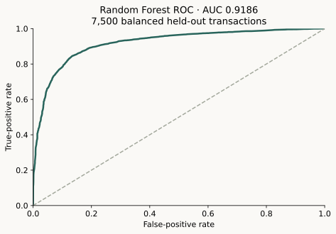

# fRaud — Transaction Classification and Customer Segmentation

An R Shiny research application combining a Random Forest transaction classifier with interactive k-means customer exploration. Purdue University, January–April 2025. Team: Allison Spahn, Himanshu Niraj Sethia, Marissa Urbanek and Chau Nguyen; faculty mentor Matthew A. Lanham.

## Research problem
Rare fraudulent transactions create different costs for missed fraud and false alerts. This project investigates transaction-level discrimination and makes the fitted model accessible through an interactive application.

## Data and original method
A balanced 25,000-transaction sample contains 12,500 fraud and 12,500 legitimate transactions. The original preparation samples each class, joins user/card/transaction records and cleans monetary fields. The recovered model drops transaction IDs, encodes character categories as numeric factor codes, and uses seed 123 with caret's stratified 70/30 split (17,500 train; 7,500 test). Default randomForest classification uses 500 trees and mtry 3. Original column order and RNG sequence are retained.

## Reproduced results
| Metric | Value |
|---|---:|
| Accuracy | 85.4533% |
| Fraud recall | 85.0400% |
| ROC AUC | 0.9186 |
| True negatives / false positives | 3,220 / 530 |
| False negatives / true positives | 561 / 3,189 |

The confusion matrix exactly reproduces the original poster. ROC AUC was computed during restoration from the same model's held-out probability scores; it supports the rounded 0.92 in the SOP/CV. Accuracy and recall are distinct. See results/metrics.csv for the actual run precision.




## Run
```sh
Rscript setup.R
Rscript train.R /private/Balanced_Processed.csv outputs
Rscript -e "shiny::runApp('.')"
```
Set FRAUD_MODEL_PATH and FRAUD_CUSTOMERS_PATH to override local defaults. Data are excluded; see data/README.md. The model trains once and the app loads its saved bundle. `src/prepare_transactions.R` preserves raw preparation but has not been rerun because the complete raw inputs are unavailable.

## Restoration and limitations
Named Shiny inputs correct a verified positional mapping bug in the original app. This does not change the fitted evaluation. Customer clustering preserves unscaled values, iter.max=20 and nstart=5; cluster results are exploratory and initialization-dependent. No new algorithm, cost policy, or threshold selection has been substituted.

Balancing precedes a random transaction split. These results do not establish future-time or unseen-customer generalization, calibrated risk, or precision at natural fraud prevalence. No deployed loss reduction or processing-time improvement was measured. Raw inputs, fitted models and record-level outputs remain private. No open-source/data license is asserted; retain collaborative attribution.

[Portfolio case study](https://chau-nguyen-research.gabledmango1.chatgpt.site/fraud.html)

## Original logistic comparison
`Rscript src/logistic_experiment.R /private/Balanced_Processed.csv outputs/logistic` restores the original logistic regression experiment. Its ROC AUC is 0.719259 (poster: 0.7193) and accuracy is 0.6592. Unlike the final Random Forest, this original formula retains the ID predictor; this methodological weakness is preserved and disclosed. It is not a newly designed matched-feature comparison.
