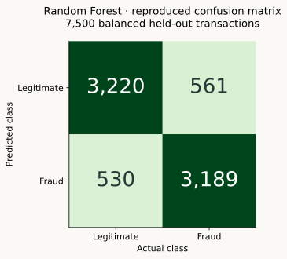

# fRaud — Transaction Classification and Customer Segmentation

An R Shiny application pairing Random Forest fraud detection with interactive k-means customer analysis. Purdue University, January–April 2025. Team: Allison Spahn, Himanshu Niraj Sethia, Marissa Urbanek and Chau Nguyen; faculty mentor Matthew A. Lanham.

## Research question
How can transaction and customer information distinguish fraud, and how can an interactive interface help analysts examine risk and customer patterns?

## Data and methods
The model uses 25,000 transactions, balanced between 12,500 fraud and 12,500 legitimate observations. Monetary fields are numeric; categorical values use numeric factor codes. Random Forest excludes the transaction ID. Seed 123 and caret's stratified 70/30 split produce 17,500 training and 7,500 test transactions. The forest uses 500 trees and mtry 3. The Shiny app also supports k-means exploration of customer summaries, with unscaled selected variables, nstart 5 and iter.max 20.

## Results
| Metric | Random Forest |
|---|---:|
| Accuracy | 85.4533% |
| Fraud recall | 85.0400% |
| ROC AUC | 0.9186 |
| True negatives / false positives | 3,220 / 530 |
| False negatives / true positives | 561 / 3,189 |




Chip usage, transaction amount and credit limit lead the forest's node-impurity importance ranking. The logistic experiment has AUC 0.719259 and accuracy 0.6592. The logistic model includes the transaction ID as a predictor.

## Run
```sh
Rscript setup.R
Rscript train.R
Rscript tests.R
Rscript -e "shiny::runApp('.')"
```
The data folder supplies the modeling and customer-analysis inputs. Optional paths can be passed to train.R; FRAUD_MODEL_PATH and FRAUD_CUSTOMERS_PATH configure the app. The raw-table preparation script accepts separate source files when available. Plot dependencies are in requirements-figures.txt.

[Portfolio case study](https://thesuncyrus.github.io/fraud.html)
